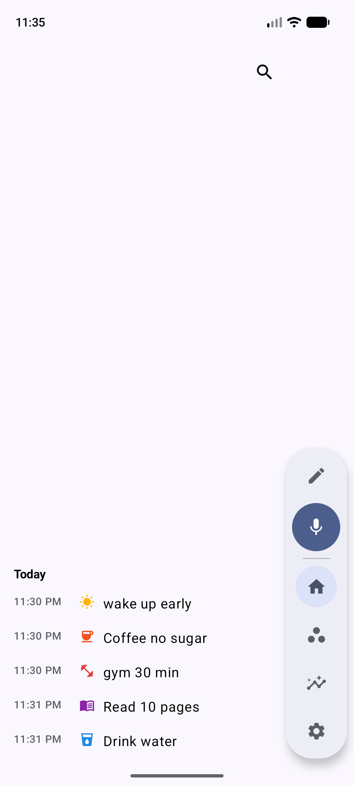
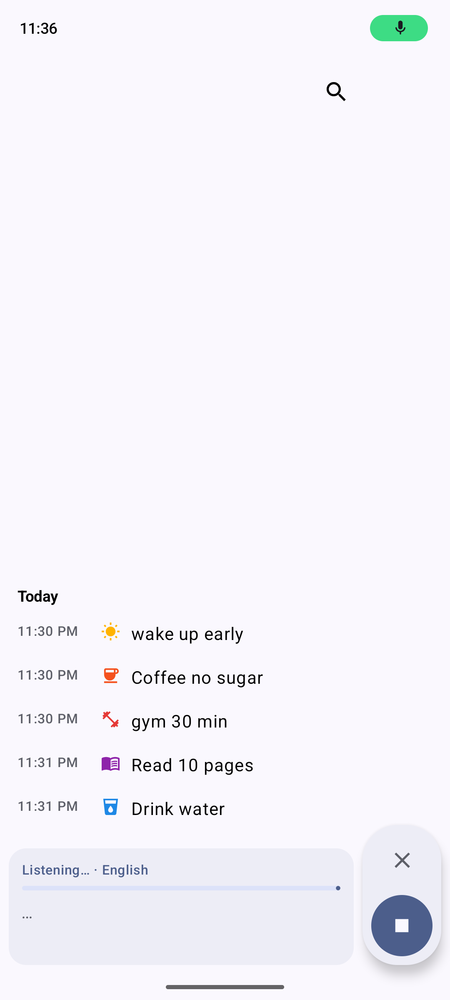
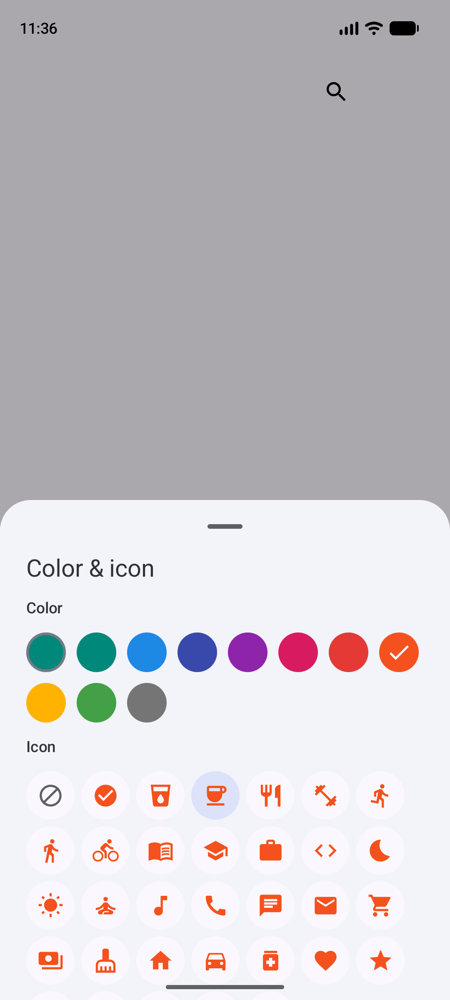
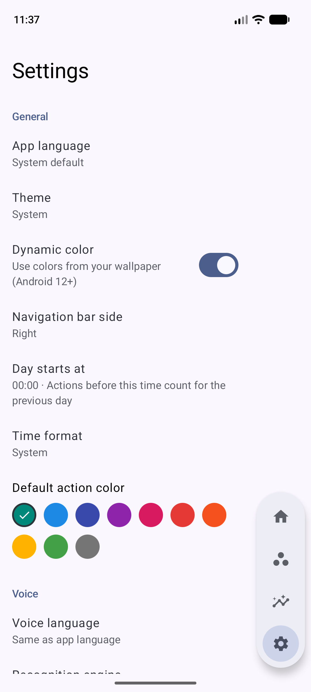

# My daily note

[](https://github.com/ngth1010v/My-daily-note/actions/workflows/build.yml)
[](LICENSE)

A fast Android app for noting the small things you do every day: **say it or type it, and it's saved**.
Voice recognition runs **completely offline** on your phone. English and Tiếng Việt.

<p>
  
  
  
  
</p>

## Features

- **Quick capture**: a floating navigation rail with *Add action* (✎) and *Add by voice* (🎤), always in thumb reach.
- **Offline voice, two passes**: words appear live while you speak ([Vosk](https://alphacephei.com/vosk/)), then an optional
  high-accuracy pass ([whisper.cpp](https://github.com/ggml-org/whisper.cpp)) replaces the sentence. Auto-stops after a pause.
  Long-press the mic to switch the voice language.
- **History by day**: chat-style list (newest at the bottom, scroll up for the past), sticky day labels and a "day starts at" setting for night owls.
  Windowed loading (Paging 3 + LazyColumn), so it stays smooth with years of entries.
- **Per-action color & icon**, edit text/description, change the time, delete with undo.
- **Suggestions**: frequent actions appear as you type; one tap logs them again.
- **Search** that ignores Vietnamese diacritics ("ca phe" finds "cà phê").
- **Home-screen widget, Quick Settings tile, app shortcuts, share-to-app.**
- **Export / import** JSON (full backup) or CSV (spreadsheet); opt-in Android backup.
- English and Vietnamese UI (per-app language), light/dark/dynamic color, navigation rail on the left or right.
- *Coming soon:* Groups and Analysis screens.

## Install

Download the APK for your phone from [Releases](https://github.com/ngth1010v/My-daily-note/releases)
(`arm64-v8a` for almost all phones; `universal` if unsure), open it and allow installing from this source.
Android 8.0+.

The first time you use voice, the app asks to download the model for your language (~35–40 MB, once).
You can also import model files manually in *Settings → Voice models* for devices that never go online.

| Model | Used for | Size | License |
|---|---|---|---|
| Vosk small English 0.15 | live recognition | 41 MB | Apache-2.0 |
| Vosk small Vietnamese 0.4 | live recognition | 34 MB | Apache-2.0 |
| Whisper tiny / base (q5_1) | high-accuracy pass (optional) | 32 / 60 MB | MIT |

Every download is verified against a SHA-256 checksum.

## Privacy

No account, no cloud, no analytics. Actions are stored only on your device. Audio is processed in memory and never saved.
The `INTERNET` permission is used only to download the voice models you ask for and, if you turn it on, to check GitHub for new releases.

## Build

Requirements: JDK 17+, Android SDK (API 37), NDK `30.0.16248370` and CMake `3.22.1` (for whisper.cpp).

```sh
git clone --recursive https://github.com/ngth1010v/My-daily-note.git
cd My-daily-note
./gradlew :app:assembleDebug        # app/build/outputs/apk/debug/
./gradlew testDebugUnitTest         # unit tests
```

Release builds are signed with the key from `keystore.properties` (gitignored); without it they fall back to the debug key.
CI publishes signed APKs to GitHub Releases when a `v*` tag is pushed (see `.github/workflows/release.yml`).

The startup profile in `app/src/main/generated` is regenerated with `./gradlew :app:generateBaselineProfile` (API 33+ emulator, English UI).

### Project layout

| Module | Contents |
|---|---|
| `app` | Activity, navigation rail, dependency wiring, widget, Quick Settings tile, shortcuts, backup agent |
| `core:data` | Room database (entries, groups, full-text search), settings (DataStore), import/export |
| `core:ui` | Theme, color palette, icons, formatters, shared strings (`values`, `values-vi`) |
| `feature:home` | Home list, text/voice input, editors |
| `feature:settings` | Settings, model manager, licenses |
| `speech:api` | Speech engine interface, mic capture + silence detection, model download manager, Android on-device engine |
| `speech:vosk` | Streaming recognition with Vosk |
| `speech:whisper` | whisper.cpp (git submodule) + JNI second pass |
| `baselineprofile` | Baseline/startup profile generator |

### Adding a language

1. Add `core/ui/src/main/res/values-xx/strings.xml` and the locale to `app/src/main/res/xml/locales_config.xml`
   and `androidResources.localeFilters` in `app/build.gradle.kts`.
2. For voice: add a value to `VoiceLanguage` and a Vosk model to `ModelRegistry` (URL, size, SHA-256).

## License

[MIT](LICENSE) © 2026 ngth1010v. Third-party components and models keep their own licenses (listed in *Settings → Open-source licenses*).
